# Roadmap-to-release workflow

This guide shows how to coordinate current Software Product Development roles when a project moves from product direction toward a release. It is an adaptable example, not a required sequence, an automated pipeline, or a claim that every project has these documents and gates. Select the parts relevant to the task and follow the project's own decision and release policies.

## What the toolkit provides

The suite provides maintained agent and skill guidance for product planning, feature design, implementation, and review. The roles do not automatically invoke one another, enforce approvals, or create project artifacts. People select the relevant guidance and make the decisions.

This repository maintains the guidance and a Copilot installer; it is not itself a product-lifecycle system. It has no established feature implementation tracker, dedicated release plans, or release/deployment automation. In a consuming project, use its actual roadmap, plans, contracts, evidence, and release process. Do not create an artifact just to follow this guide.

## An adaptable path

Use the diagram as a map of possible handoffs, not as a mandatory checklist. A small fix may start with an existing contract or clear request and skip roadmap and release planning. Release readiness applies when a project is preparing a release candidate under its own policy.

```mermaid
flowchart TD
    A[Product context and evidence] --> B{Roadmap work needed?}
    B -- Yes --> C[Draft or update roadmap]
    C --> D[Product-plan reviewer reports findings]
    D --> E{Product owner approves direction?}
    E -- No: revise or defer --> C
    E -- Yes --> F{Release plan needed?}
    B -- No --> F
    F -- Yes --> G[Plan release from approved milestone]
    G --> H[Product-plan reviewer reports findings]
    H --> I{Product owner approves release scope?}
    I -- No: revise or defer --> G
    I -- Yes --> J{Feature contract needed?}
    F -- No --> J
    J -- Yes --> K[Design feature contract]
    K --> L[Feature-contract reviewer reports findings]
    L --> M{User accepts contract?}
    M -- No: resolve decisions or defer --> K
    M -- Yes --> N{Implementation separately authorized?}
    J -- No --> N
    N -- No --> O[Pause implementation]
    N -- Yes --> P[Plan testable tasks mapped to criteria]
    P --> Q[Select a ready task]
    Q --> R[Add or reuse a focused test; confirm expected failure where applicable]
    R --> S[Implement the smallest change; refactor without changing behavior]
    S --> T[Rerun focused tests and affected regressions]
    T --> U{More tasks?}
    U -- Yes --> Q
    U -- No --> V[Validate all feature criteria; report gaps]
    V --> W[Independent implementation review; address findings and recheck]
    W --> X{Release candidate in scope?}
    X -- No --> Y[Report implementation result]
    X -- Yes --> Z[Run project-defined checks and record candidate evidence]
    Z --> AA[Change reviewer assesses release readiness]
    AA --> AB{Release approver decides go?}
    AB -- No --> AC[Hold; resolve blockers and reassess]
    AC --> Z
    AB -- Yes --> AD{Delivery separately authorized?}
    AD -- No --> AE[Do not deliver]
    AD -- Yes --> AF[Use the project's authorized delivery path]
```

The arrows show possible sequencing, not automatic agent invocation or authorization. A review reports findings; it does not approve a plan, accept a feature contract, authorize implementation, or make the release go/no-go decision.

## Roles and decisions

| Work | Current guidance | Decision owner or boundary |
|---|---|---|
| Draft a roadmap or release plan | [product-planner](../../src/agents/design-and-planning/product-planner.md), using the [roadmap planning workflow](../../src/skills/design-and-planning/roadmap-planning-workflow.md) or [release planning workflow](../../src/skills/design-and-planning/release-planning-workflow.md) | The user retains priorities, commitments, and release-scope approval. |
| Independently review a roadmap or release plan | [product-plan-reviewer](../../src/agents/design-and-planning/product-plan-reviewer.md) | Read-only findings; the reviewer does not approve the plan. |
| Define and review a feature contract | [feature-designer](../../src/agents/design-and-planning/feature-designer.md) and [feature-contract-reviewer](../../src/agents/design-and-planning/feature-contract-reviewer.md) | The user resolves material decisions and accepts the contract; review is not acceptance. |
| Implement and verify an accepted, authorized change | [code-engineer](../../src/agents/implementation/code-engineer.md) | Requires implementation authorization and independent implementation review; neither is release approval. |
| Assess release readiness | [change-reviewer](../../src/agents/review-and-security/change-reviewer.md), using the project's approved release requirements and candidate evidence | Read-only review; the designated release approver decides go/no-go. |
| Deliver a release | The project's documented, authorized delivery path | Requires separate, explicit authorization for the specific action and candidate. The toolkit does not provide release/deployment automation. |

These handoffs describe available guidance, not a staffing model or runtime orchestration. Agent definitions and skills retain their own boundaries; the [suite guide](../suites/software-product-development.md) lists current roles and task routes.

## Applying the path

1. **Establish the project context.** Identify the task, relevant product direction, canonical documents, decision owner, and project rules. Separate current capability and evidence from proposals, assumptions, and unknowns.

2. **Plan only when useful.** For roadmap work, use the roadmap planning guidance and request an independent review before the product owner decides direction. For release planning, start from an approved roadmap milestone; a proposed milestone is not approved release scope. The product-plan reviewer can report gaps and questions but cannot resolve product decisions.

3. **Define detailed behavior when needed.** Use feature design for work that needs a contract. Resolve open decisions with the user, obtain independent contract review, and get user acceptance before handoff. A small bounded change need not receive a new feature document solely to follow this guide.

4. **Implement only with authorization.** The code engineer first breaks the work into small, testable tasks mapped to the agreed criteria, scenarios, and relevant test tiers. For each behavior change, the [test-driven implementation workflow](../../src/skills/implementation/test-driven-implementation-workflow.md) uses a focused test-first red-green-refactor cycle, then reruns focused tests and affected regressions. Reuse existing tests when they already cover the behavior; do not force an artificial failing test for documentation-only or behavior-preserving work. After the tasks, validate all in-scope criteria and report any unmet or unverified outcomes. Complete independent implementation review, address applicable findings, and recheck affected behavior. Implementation and its review are not release approval.

5. **Assess a real candidate against project requirements.** When a release is in scope, follow the project's approved plan and release policy. Record the candidate identity, applicable checks, configurations, environment, and actual results. The [release workflow](../../src/skills/build-and-delivery/release-workflow.md) provides reusable readiness guidance; it does not establish project-specific gates or prove that they passed.

6. **Keep readiness, approval, and delivery distinct.** The change reviewer may assess candidate readiness in per-release mode. The designated release approver makes the go/no-go decision under project policy. A go decision does not itself authorize publishing or deployment; delivery requires separate authorization and verification through the project's path.

If a necessary decision, independent review, authorization, project rule, or evidence is unavailable, pause the affected step and report the gap. Do not substitute self-review, infer approval, or present missing evidence as a pass.

## Related guidance

- [Software Product Development suite](../suites/software-product-development.md): current roles, packages, and task routes.
- [Product planning workflow](../../src/skills/design-and-planning/product-planning-workflow.md): planning ownership, sequencing, and approval boundaries.
- [Feature design workflow](../../src/skills/design-and-planning/feature-design-workflow.md): feature contracts and implementation handoff.
- [Test-driven implementation workflow](../../src/skills/implementation/test-driven-implementation-workflow.md): implementation planning and verification.
- [Release workflow](../../src/skills/build-and-delivery/release-workflow.md): release readiness and authorized delivery boundaries.
